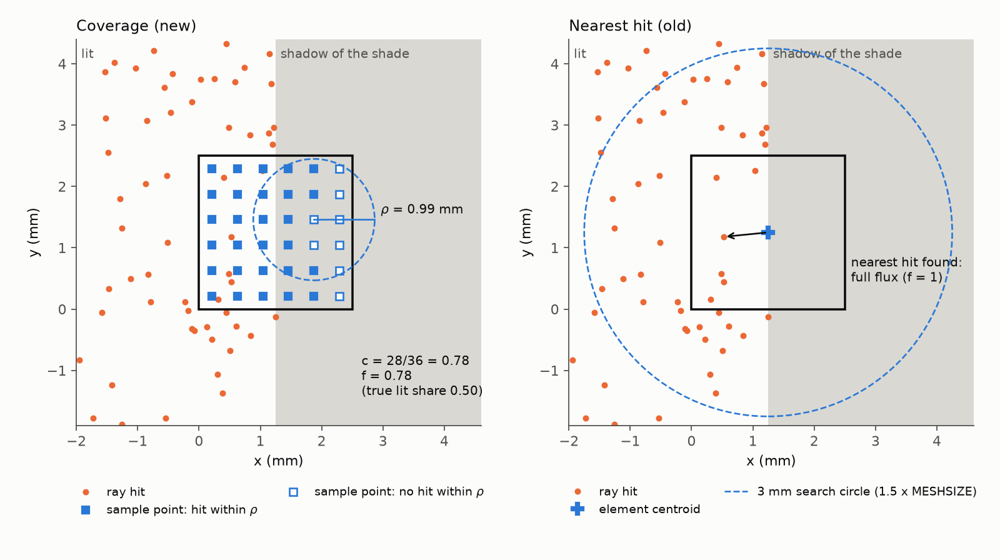
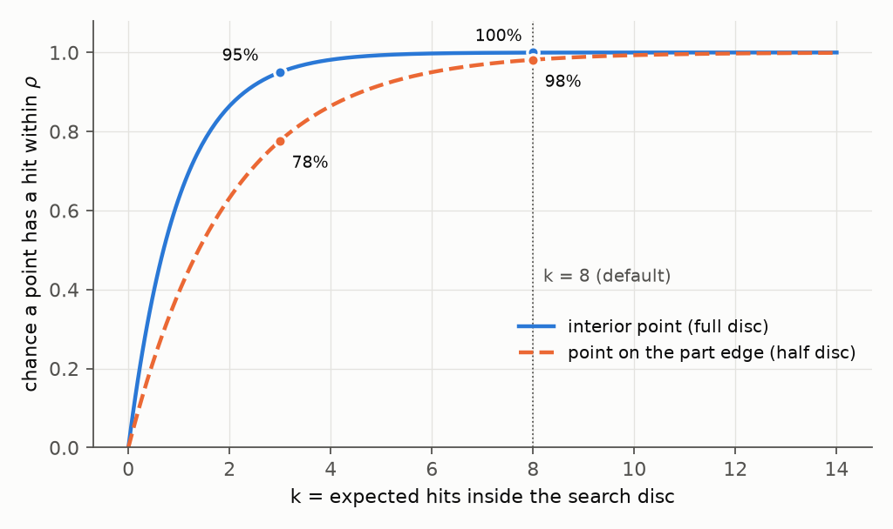
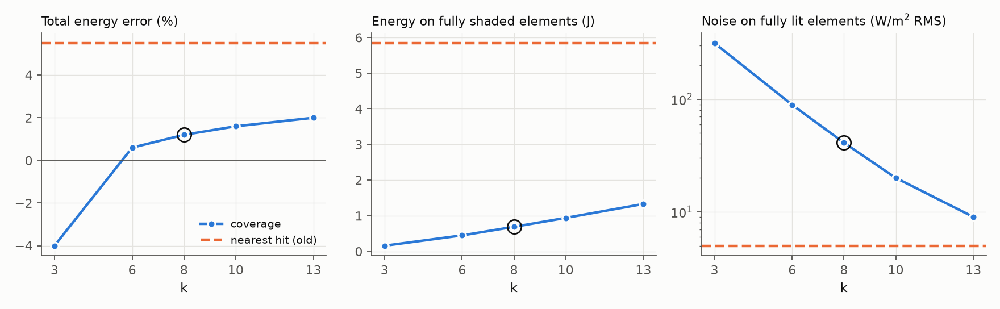
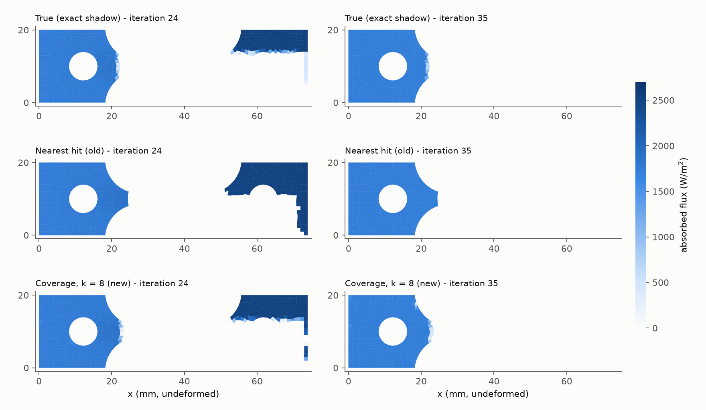
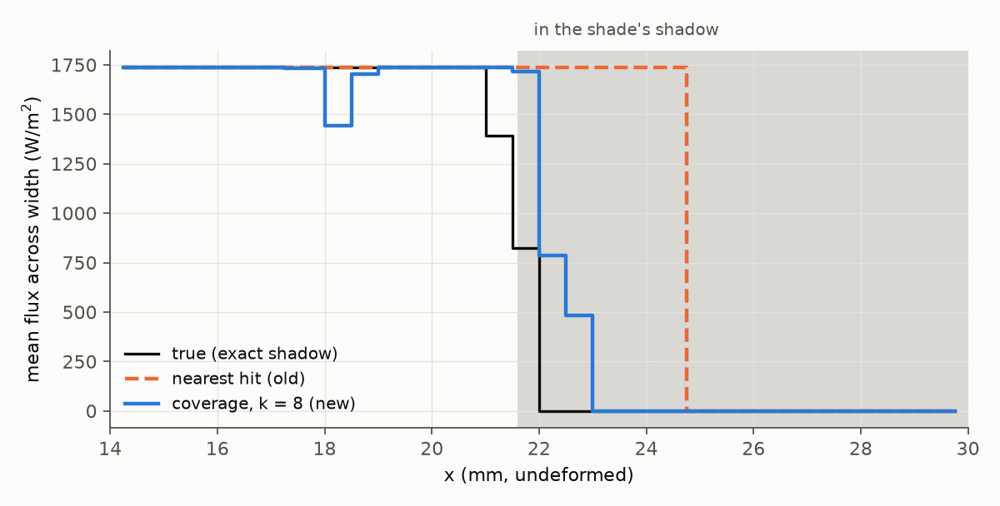
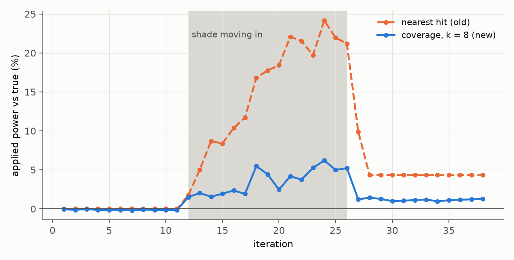

# Coverage flux mapping

*How ray-traced hit points become per-element flux in Abaqus. Added 2026-11-21.*

Code:
- `map_flux_to_elements(..., method='coverage')` in `Abaqus/scripts/starlib.py`.
- `FLUX_MAPPING` in `Scenarios/DogboneScenario1/scripts/starsimUMATtwist.py` selects `'coverage'` (default) or `'nearest'` (the old method).

---

## 1. The problem coverage solves

OTSun returns a cloud of **hit points**: where rays landed on the dogbone. Each hit has a flux value

$$q_\text{hit} = I\,\alpha\,|\cos\theta|$$

- $I$ is the solar irradiance (`SOLAR_IRRADIANCE`).
- $\alpha$ is the absorptivity (`ABSORPTIVITY_DICT[OBJECT_MATERIAL]`).
- $\theta$ is the angle between the sun direction and the surface normal.

This is a flux **density** (W/m²): the flux the surface receives *if it is lit*. It is not a share of the beam's power.

Abaqus needs one flux value per element. The old `'nearest'` method gave each element the $q_\text{hit}$ of the closest hit within 3 mm (`1.5 * MESHSIZE`) of its centre. The mesh is really 0.5–1 mm, so 3 mm spans several elements, and any element with a lit hit within that distance got **full** flux. The consequences in run 0.82:

- **Bleed:** flux spread up to about 3 mm into the shade's shadow.
- **Partly lit elements:** elements cut by the shadow edge got full flux.
- **Stray rays:** one ray grazing the shade edge at the free-end tip gave 15 elements full flux, about 40× its real power.
- **Total:** +5.5% energy over the run, and +24% in the worst iteration.

Abaqus itself was not the problem: its `*Dflux` values matched the mapped values exactly. See section 20 of `claude_changes_documentation.md`.

What an element should get is

$$q_e = I\,\alpha\,|\cos\theta_e|\;f_e$$

where $f_e$ is the **fraction of the element that is lit** (0 = fully shaded, 1 = fully lit). Everything except $f_e$ is known exactly, so the mapping problem is: **estimate each element's lit fraction from the hit points.**

---

## 2. The idea

Rays leave the sun window on a uniform random grid, so on a lit surface the hits are scattered evenly and randomly. Pick a small search radius $\rho$ (section 3.2):

- **Lit point:** almost certainly has a ray hit within $\rho$ of it.
- **Shaded point:** has none, because no rays reach the shadow.

So we place sample points across each element and check each one: is there a hit within $\rho$? The share of sample points that pass is the **coverage** $c_e$, and it estimates the lit fraction.



*Figure 1. One element straddling a shadow edge (grey = shade's shadow; dots = ray hits).*
- **Left, coverage:** each of the 36 sample points is filled if a hit lies within ρ and hollow if not. The element gets f = 0.78.
- **Right, nearest hit:** the old method finds a hit inside its 3 mm search circle and gives the element full flux.
- **Scale:** the element is drawn 2.5 mm wide so the mechanism is visible. Real elements are about 1 mm, roughly the size of ρ.

The estimate on the left (0.78) is above the true 0.50 because points up to about ρ inside the shadow still "see" a lit hit nearby. Coverage blurs the shadow edge by about ρ (≈1 mm). The old method blurs it by up to 3 mm, and at full strength.

---

## 3. The equations

### 3.1 How many hits to expect

OTSun fires $N$ rays (`N_RAYS`) uniformly through the sun window of area $A_w$, which sits perpendicular to the sun direction. The ray density across the beam is

$$n_0 = \frac{N}{A_w} \quad \text{(rays per m}^2\text{ of beam cross-section)}$$

A surface tilted by $\theta$ to the beam catches the beam over a smaller cross-section: a patch of area $a$ intercepts beam area $a\,|\cos\theta|$. So on a fully lit surface the expected **hit density** is

$$\lambda = n_0\,|\cos\theta| = \frac{N}{A_w}\,|\cos\theta| \quad \text{(hits per m}^2\text{ of surface)}$$

Every ray that reaches the dogbone is recorded as a hit, whether or not it is absorbed, so $\alpha$ does not appear here. This was checked on run 0.82: $n_\text{hits}\cdot I A_w \alpha/N$ matches the exactly computed absorbed power to within 0.4%.

> **Run 0.82:**
> - $N = 6000$ and $A_w \approx 1.45\times10^{-3}$ m², so $n_0 \approx 4.1$ rays/mm².
> - The flat part of the dogbone faces up with the sun at 50° zenith, so $|\cos\theta| = 0.64$ and $\lambda \approx 2.6$ hits/mm².
> - The median element is about 0.9 mm², so a fully lit element gets only **about 2–3 hits**.
>
> That is too few to judge an element by counting its own hits (a fully lit element gets zero about 9% of the time). It is why coverage looks in a radius rather than inside the element.

### 3.2 The search radius ρ, from the target k

Uniform random hits form a *Poisson process*: the number of hits in a region of area $a$ is Poisson distributed with mean $\lambda a$. For a disc of radius $\rho$ around a lit point, the expected number of hits is

$$k = \lambda\,\pi\rho^2$$

and the probability that the disc is empty is

$$P(\text{no hit within } \rho) = e^{-k}$$

**k is the setting; ρ is calculated from it.** k says how many hits you want inside the search disc on average. ρ then follows from the hit density:

$$\boxed{\rho = \sqrt{\frac{k}{\pi\,\lambda}}}$$

- **Fewer rays** (lower $\lambda$) or **a more tilted surface** (lower $|\cos\theta|$): ρ grows so the disc still holds about k hits.
- **More rays:** ρ shrinks and shadow edges get sharper.

The code computes ρ separately for every element from its own deformed normal. $|\cos\theta|$ is floored at 0.05 (`COVERAGE_MIN_COS`) so ρ cannot blow up at grazing angles.

> **Run 0.82, k = 8:** $\rho = \sqrt{8/(\pi \times 2.6)} \approx 0.99$ mm. The log prints the median ρ every iteration.

### 3.3 Coverage and the lit fraction

Each element gets a grid of sample points:
- **Quads:** 6 × 6 = 36 points, bilinear across the deformed element.
- **Triangles:** 21 points on the matching barycentric grid.

For each sample point $s_j$:

$$\text{covered}_j = \begin{cases}1 & \text{if } \min_i \lVert s_j - h_i \rVert \le \rho\\ 0 & \text{otherwise}\end{cases}
\qquad
c_e = \frac{1}{M}\sum_{j=1}^{M} \text{covered}_j$$

where $h_i$ are the hit points and $M$ is the number of sample points.

Even on a fully lit element, a sample point is covered only with probability $1-e^{-k}$, from 3.2. The raw coverage is therefore divided by that expected value to give an unbiased lit fraction:

$$\boxed{f_e = \min\!\left(1,\; \frac{c_e}{1-e^{-k}}\right)}
\qquad\qquad
\boxed{q_e = I\,\alpha\,|\cos\theta_e|\; f_e}$$

$|\cos\theta_e|$ comes from the element's deformed normal and the sun direction, so the magnitude is exact and noise-free. The rays decide only *how much of the element is lit*.

### 3.4 Discarding isolated hits

A single ray that slips past the edge of a shade would otherwise "light" every sample point within ρ of it. Inside a genuinely lit region, every hit has neighbours: the chance that a lit hit has no other hit within $2\rho$ is

$$P = e^{-\lambda\pi(2\rho)^2} = e^{-4k} \approx 10^{-14} \quad (k=8)$$

and still only $e^{-2k} \approx 10^{-7}$ on the edge of the part, where half the disc is off the part. So any hit with **no other hit within 2ρ** (`COVERAGE_ISOLATION = 2`) is treated as a stray and dropped before computing coverage. Each hit's own ρ comes from its $|\cos\theta|$, recovered from its flux value as $q_\text{hit}/(I\alpha)$.

> **Run 0.82:**
> - 9 hits were discarded over all 38 iterations.
> - One of them was the grazing ray at the free-end tip in iteration 27.
> - Flux on fully shaded elements in that iteration dropped from 0.057 W (old method) to 0.003 W.

### 3.5 Power check in the log

Each ray carries beam power $I A_w / N$, and a fraction $\alpha$ of it is absorbed. Every iteration logs the power applied to the mesh next to the ray estimate

$$P_\text{rays} = n_\text{hits}\,\frac{I\,A_w}{N}\,\alpha$$

for example:

```
map_flux_to_elements (coverage, k=8.0): 926 hits (0 isolated, discarded); rho median 0.99 mm;
elements 673 dark / 15 partial / 386 full; power applied 0.6240 W vs ray estimate 0.6269 W
```

These should agree to within a few percent, the ray-count noise. A large gap means something is off: a wrong window area, wrong units, or a geometry mismatch.

---

## 4. Choosing k

k trades two errors against each other:

- **Small k (small ρ):** sharp shadow edges, but a lit sample point often finds no hit, so lit elements are noisy. Elements on the **outer edges and hole edges** of the dogbone also come out too low, because half of each sample point's search disc is off the part. Such points are covered only with probability $1-e^{-k/2}$, while the normalisation assumes $1-e^{-k}$.
- **Large k (large ρ):** smooth, accurate lit regions, but the shadow edge is blurred by about ρ, so a little flux leaks into the shade.



*Figure 2. Chance that a lit sample point has a hit within ρ, for an interior point (full disc) and a point on the part's edge (half disc).*
- **k = 3:** edge points are covered only 78% of the time against 95% inside, so edge elements are under-counted by about 18%.
- **k = 8:** the two curves are within 2% of each other.

k = 3, 6, 8, 10 and 13 were tested on all 38 iterations of run 0.82. Each was compared with the exact flux, computed by casting rays from 36 points per element at the shade geometry.



*Figure 3. Error measures vs k over the whole run (blue). The dashed orange line is the old nearest-hit method. The circled point is the chosen k = 8.*

| k | ρ (run 0.82) | Total energy error | Energy on fully shaded elements | Noise on fully lit elements |
|---|---|---|---|---|
| Old nearest hit | (3 mm search) | +5.5% | 5.84 J | 5 W/m² |
| 3 | 0.61 mm | −4.0% | 0.16 J | 314 W/m² |
| 6 | 0.86 mm | +0.6% | 0.45 J | 89 W/m² |
| **8 (default)** | **0.99 mm** | **+1.2%** | **0.69 J** | **41 W/m² (≈2%)** |
| 10 | 1.11 mm | +1.6% | 0.94 J | 20 W/m² |
| 13 | 1.26 mm | +2.0% | 1.33 J | 9 W/m² |

The true energy over the run is 133.6 J. Fully lit flux is about 1,700–2,600 W/m².

**k = 8** is the default (`COVERAGE_HITS` in starlib). It cuts the energy landing in shadows by about 8× compared with the old method and keeps the total within about 1%, with about 2% noise on lit elements. Because k is defined in hits rather than millimetres, it stays valid if `N_RAYS` changes.

---

## 5. Results on run 0.82



*Figure 4. Absorbed flux on the undeformed mesh. Left: iteration 24, with the shade moving in. Right: iteration 35, fully shaded except the fixed end.*
- **Top:** exact.
- **Middle:** old nearest hit. Flux spills well past the shadow edge near x ≈ 22 mm and into the free-end shadow.
- **Bottom:** coverage. It follows the exact edge to within about 1 mm, with partial values along the edge.

A few edge elements still show small dips (white specks), which is the remaining noise.



*Figure 5. Iteration 35, flux averaged across the width near the shadow edge (grey = shade's shadow).*
- **Old method:** full flux continues about 3 mm into the shadow.
- **Coverage:** ramps down over about 1 mm, the remaining blur of ρ.



*Figure 6. Applied power relative to the exact value, per iteration.*
- **Old method:** up to +24% while the shade moves in, and +4.3% once fully shaded.
- **Coverage:** at most +6%, and about +1% once fully shaded.

---

## 6. Limitations

- **Edge blur of about ρ:** shadow edges are smeared by up to ρ (≈1 mm at k = 8 and 6000 rays). It biases slightly toward extra flux (+1.2% energy over run 0.82). More rays shrink ρ as $1/\sqrt{N}$: 4× the rays halves the blur.
- **Element resolution:** an element has one flux value, so an edge cutting through it can only be represented by its average.
- **Noise:** about 2% RMS on fully lit elements, and a little more along the part's outer and hole edges.
- **Direct sunlight only:** coverage measures *whether* a spot is lit, not *how strongly*, and the magnitude is always $I\alpha|\cos\theta|$. With reflections on (`ABSORPTION_ONLY = False`), light reflected onto the dogbone would not be counted. The old method has the same limitation; only summing ray power per element would capture it.
- **Uniform beam assumed:** the sun window must emit rays uniformly, as OTSun's `SunWindow` does with no angular spread.
- **Mesh-independent:** nothing depends on `MESHSIZE`. Each element is sampled on its own deformed shape, so 0.5 mm, 1 mm, triangular and hole-edge elements are all handled. The resolution limit is the larger of the element size and ρ.
- **Cost:** about 0.2 s per iteration (SciPy KD-tree queries for about 38,000 sample points), which is negligible next to ray tracing and the Abaqus job.

---

## 7. Using it

**In `starsimUMATtwist.py`:**

```python
FLUX_MAPPING = 'coverage'  # or 'nearest' (old behaviour; search radius 1.5*MESHSIZE)
```

**Requirements:**
- The FreeCAD macro (`SolarFluxCalc.FCMacro`) now writes `NUM_RAYS` and `SUN_WINDOW_AREA` into `freecad_to_abaqus.json`. Coverage needs the updated macro, and raises a clear error if `SUN_WINDOW_AREA` is missing.
- The script reads each element's deformed nodes from the same ODB frame as before (`get_deformed_element_nodes`, new in starlib), so the mapping uses exactly the geometry that was ray-traced.

**Constants in `starlib.py`** (normally left alone):

| Constant | Default | Meaning |
|---|---|---|
| `COVERAGE_HITS` (k) | 8.0 | expected hits inside the search disc on a fully lit surface; sets ρ |
| `COVERAGE_SAMPLES` | 6 | sample grid per element edge (6 × 6 = 36 points for quads) |
| `COVERAGE_ISOLATION` | 2.0 | a hit with no other hit within this many ρ is discarded |
| `COVERAGE_MIN_COS` | 0.05 | floor on \|cos θ\| when computing ρ |

**Calling the function directly:**

```python
elem_nodes = get_deformed_element_nodes(job_name, OBJECT_NAME)
elem_centroids = {l: tuple(np.mean(p, axis=0)) for l, p in elem_nodes.items()}
elem_fluxes = map_flux_to_elements(
    xyz_data, elem_centroids, method='coverage', elem_nodes=elem_nodes,
    sun_dir=SUN_DIR, irradiance=SOLAR_IRRADIANCE, absorptivity=0.9,
    num_rays=N_RAYS, sun_window_area=freecad_result['SUN_WINDOW_AREA'])
```

---

## 8. How it was validated

1. For each of the 38 iterations of run 0.82, the deformed mesh was read from the ODB that the iteration's ray tracing used: `loading` for iteration 1, `SMAHeatTransient_{NN-1}` after that.
2. **Exact flux:** 36 points per element were tested for occlusion by the shade quad (from `raytrace_scene/scene_NN.json`) along the sun direction, then $q = I\alpha|\cos\theta|\times$ lit share. The exact total power matches the ray-count estimate to within 0.4% over the run, which confirms the reference.
3. The starlib function itself was run in Abaqus on each iteration's saved hits (`flux_data/flux_data_NN.csv`) and compared element by element with the exact values and with the old method's values.

The scripts used for the tests and the figures are not stored in the repo. Ask Claude to recreate them if needed.
